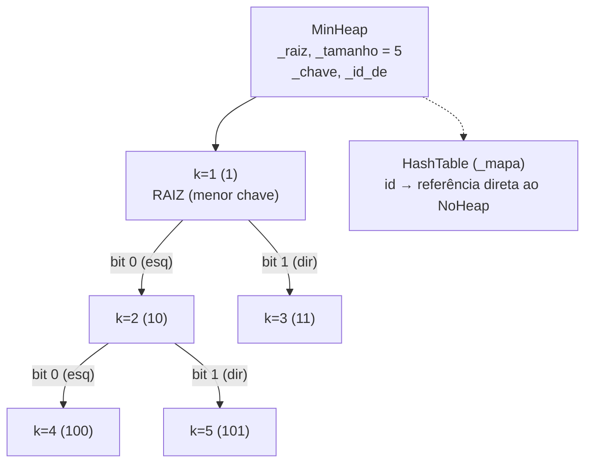

# Estudo Completo do Min-Heap no Projeto SIGAE WEB

Guia técnico detalhado sobre a estrutura `MinHeap` implementada em `core/heap.py`, como ela é organizada em memória **sem usar `list` ou `dict`**, como ordena pacientes e médicos, o passo a passo exato de cada operação e como se integra ao restante do sistema.

---

## 1. Qual é o papel do Heap no SIGAE WEB?

No pronto atendimento, precisamos responder em tempo rápido duas perguntas críticas:

1. **Qual paciente deve ser chamado agora?** (o de maior urgência clínica, respeitando devoluções e desempates).
2. **Qual médico disponível deve atender agora?** (o que concluiu menos atendimentos, desempatando por quem está há mais tempo sem receber paciente).

Em ambos os casos, queremos sempre o **menor elemento segundo uma chave de ordenação** — exatamente o que um **Min-Heap binário** entrega:

- Consultar o próximo (`raiz()`): **O(1)**
- Inserir novo elemento (`inserir()`): **O(log n)**
- Extrair o próximo (`extrair_minimo()`): **O(log n)**
- Reclassificar um elemento que já está no meio da fila (`alterar_prioridade(id)`): **O(log n)**
- Remover um elemento específico por ID, como num cancelamento (`remover(id)`): **O(log n)**

O projeto usa **uma única classe genérica `MinHeap`** (`core/heap.py`) em **duas instâncias independentes** dentro de `core/sistema.py`:

- `self._heap_pacientes`: guarda apenas pacientes com situação **`Aguardando`**.
- `self._heap_medicos`: guarda apenas médicos com situação **`Disponível`** (médicos *Em atendimento* saem do heap e retornam ao concluir ou cancelar — ADR-005).

---

## 2. Por que o Heap foi feito sem vetor (`list`)?

Na maioria dos livros, um Heap é guardado em um vetor (`list`), onde o filho esquerdo de `i` fica em `2*i + 1` e o direito em `2*i + 2`.

No SIGAE WEB, a equipe decidiu proibir **todas** as coleções prontas do Python (`list`, `dict`, `set`, `frozenset`, `heapq`, `sorted`) dentro de `core/` (ADR-010, garantido automaticamente pelo teste AST `tests/unit/test_sem_estruturas_prontas.py`).

Por isso, conforme o **ADR-008**, o `MinHeap` foi implementado como uma **árvore binária completa explícita com nós ligados** (`NoHeap`), combinada com a **`HashTable` própria do projeto** para o mapa `id -> nó`.

---

## 3. Como o Heap é estruturado em memória

### 3.1 O nó (`NoHeap` — `core/heap.py:14-21`)

Cada nó da árvore guarda apenas 4 ponteiros/referências (usando `__slots__` para economia de memória):

```python
class NoHeap:
    __slots__ = ("item", "pai", "esq", "dir")
```

- `item`: o objeto armazenado (`Paciente` ou `Medico`).
- `pai`: referência para o nó pai (`None` apenas na raiz).
- `esq`: referência para o filho esquerdo (`None` se não existir).
- `dir`: referência para o filho direito (`None` se não existir).

### 3.2 A classe `MinHeap` (`core/heap.py:24-36`)

```python
class MinHeap:
    def __init__(self, chave, id_de):
        self._chave = chave          # função que devolve a tupla de ordenação do item
        self._id_de = id_de          # função que devolve o ID inteiro único do item
        self._raiz = None            # ponteiro para o nó raiz (posição k = 1)
        self._tamanho = 0            # quantidade atual de nós (n)
        self._mapa = HashTable()     # mapa id -> NoHeap em O(1) médio
```



### 3.3 As duas invariantes fundamentais do Min-Heap

Após **toda** operação, o `MinHeap` garante simultaneamente:

1. **Propriedade estrutural (árvore binária completa):** todos os níveis estão completamente preenchidos da esquerda para a direita, exceto possivelmente o último nível, que é preenchido estritamente da esquerda para a direita.
   - Isso garante que a altura da árvore é sempre $\lfloor \log_2 n \rfloor$, impedindo que a árvore fique desbalanceada.
2. **Propriedade de ordem (Min-Heap):** para todo nó `u` (exceto a raiz),
   $$\text{chave}(\text{pai}(u)) \le \text{chave}(u)$$
   - Consequência imediata: **a raiz (`k = 1`) sempre contém o elemento de menor chave de toda a árvore**.
   - Atenção: o Heap **não** é uma Árvore Binária de Busca (BST)! Não existe regra de "esquerdo menor que direito"; a única relação garantida é entre **pai e filhos**.

---

## 4. O truque dos bits: como achar a posição `k` sem vetor (`_no_na_posicao`)

Em uma árvore binária completa numerada por nível começando em `1`:

```text
              1 (bin: 1)
           /             \
      2 (10)             3 (11)
     /      \           /      \
  4 (100)  5 (101)   6 (110)  7 (111)
```

Observe a representação binária de cada posição `k`:

| Posição `k` | Binário | Sem o bit mais alto | Caminho a partir da raiz |
|---:|---|---|---|
| `1` | `1` | *(vazio)* | Fica na própria raiz |
| `2` | `10` | `0` | Esquerda |
| `3` | `11` | `1` | Direita |
| `4` | `100` | `00` | Esquerda → Esquerda |
| `5` | `101` | `01` | Esquerda → Direita |
| `6` | `110` | `10` | Direita → Esquerda |
| `7` | `111` | `11` | Direita → Direita |

**Por que isso funciona sempre?**
Porque multiplicar `k` por 2 (`k << 1`, acrescentar bit `0` à direita) vai para o filho esquerdo (`2k`), e `2k + 1` (acrescentar bit `1` à direita) vai para o filho direito. Lendo os bits de `k` da esquerda para a direita (ignorando o `1` inicial que representa a raiz), cada bit diz exatamente qual ramo descer!

Veja o código real em `core/heap.py:56-65`:

```python
def _no_na_posicao(self, k: int) -> NoHeap:
    no = self._raiz
    if no is None:
        raise HeapInvalidoError("acesso a posição em heap vazio")
    for bit in range(k.bit_length() - 2, -1, -1):
        proximo = no.dir if (k >> bit) & 1 else no.esq
        if proximo is None:
            raise HeapInvalidoError(f"posição {k} inalcançável na árvore")
        no = proximo
    return no
```

- **Exemplo prático (`k = 6`, binário `110`):**
  - `k.bit_length()` = `3`, então `range(1, -1, -1)` percorre `bit = 1` e `bit = 0`.
  - `bit = 1`: `(6 >> 1) & 1` = `3 & 1` = `1` → desce para `no.dir` (nó `3`).
  - `bit = 0`: `(6 >> 0) & 1` = `6 & 1` = `0` → desce para `no.esq` (nó `6`).
- **Custo:** percorre no máximo $\lfloor \log_2 k \rfloor$ ponteiros → **O(log n)**.

---

## 5. Como o Heap ordena (chaves compostas e desempates)

O Python compara tuplas **lexicograficamente** (elemento por elemento, da esquerda para a direita; se o primeiro empatar, olha o segundo, e assim por diante). O `MinHeap` chama `self._chave(item)` nas comparações, o que permite ordenar qualquer entidade com critérios múltiplos de forma 100% determinística.

### 5.1 Chave do Heap de Pacientes (`core/paciente.py:67-74`)

```python
def chave_heap(self) -> tuple[int, int, str, int]:
    if self.prioridade == 1:
        classe = 0          # Emergência: SEMPRE no topo absoluto
    elif self.retorno:
        classe = 1          # Devolvido por cancelamento: logo atrás das Emergências
    else:
        classe = 2          # Demais pacientes (prioridades 2 a 5)
    return (classe, self.prioridade, self.horario, self.id)
```

**Ordem de decisão (menor tupla sai primeiro):**

1. **`classe`** (`0`, `1` ou `2`):
   - `0`: **Emergência (`prioridade == 1`)** — nunca é ultrapassada por ninguém (nem por devolvidos).
   - `1`: **Paciente devolvido (`retorno == True`, prioridades 2 a 5)** — volta para a frente da fila, logo atrás das Emergências (ADR-012).
   - `2`: **Demais pacientes aguardando**.
2. **`prioridade`** (`1` a `5`): quanto menor o número, mais grave (`1 = Emergência`, `2 = Muito urgente`, `3 = Urgente`, `4 = Pouco urgente`, `5 = Não urgente`). Também desempata dois devolvidos entre si!
3. **`horario`** (string ISO `"AAAA-MM-DD HH:MM:SS"`): quem chegou antes tem string lexicograficamente menor (válido inclusive entre dias diferentes — ADR-009).
4. **`id`** (inteiro crescente): garante desempate determinístico se dois cadastros acontecerem no mesmo segundo.

**Exemplo de ordenação resultante:**

| Paciente | Prioridade | Retorno | Chegada | Chave `(classe, prio, horario, id)` | Ordem |
|---|---:|---|---|---|---:|
| E (Emergência) | 1 | False | 08:05:00 | `(0, 1, "2026-11-27 08:05:00", 4)` | **1º** |
| D (Devolvido) | 4 | True | 08:00:00 | `(1, 4, "2026-11-27 08:00:00", 1)` | **2º** |
| M (Muito urgente) | 2 | False | 08:02:00 | `(2, 2, "2026-11-27 08:02:00", 2)` | **3º** |
| U (Urgente) | 3 | False | 08:01:00 | `(2, 3, "2026-11-27 08:01:00", 3)` | **4º** |

### 5.2 Chave do Heap de Médicos (`core/medico.py:42-43`)

```python
def chave_heap(self) -> tuple[int, int, int]:
    return (self.concluidos, self.seq_ultima_atribuicao, self.id)
```

**Ordem de decisão (menor tupla é escolhido primeiro):**

1. **`concluidos`**: quem concluiu menos atendimentos (cancelamento **não** incrementa este contador).
2. **`seq_ultima_atribuicao`**: valor do **relógio lógico inteiro** (`1, 2, 3...`) gravado no momento da chamada (nunca atribuído = `0`). Quem recebeu paciente há mais tempo tem número menor e vence o empate (ADR-006).
3. **`id`**: desempate final determinístico (por isso, com A, B e C zerados, as 3 primeiras chamadas vão na ordem A, B, C).

---

## 6. Por que trocamos ITENS e não NÓS? + O Mapa `id -> nó`

Em `core/heap.py:67-70`:

```python
def _trocar_itens(self, no_a: NoHeap, no_b: NoHeap) -> None:
    no_a.item, no_b.item = no_b.item, no_a.item
    self._mapa.atualizar(self._id_de(no_a.item), no_a)
    self._mapa.atualizar(self._id_de(no_b.item), no_b)
```

**Vantagem crucial:**
- Trocar os **nós** fisicamente exigiria reconectar até 8 ponteiros (`pai`, `esq`, `dir` dos dois nós, dos pais e dos filhos), além do caso especial da raiz.
- Trocar apenas os **itens** (`no_a.item` ↔ `no_b.item`) preserva intacta toda a estrutura da árvore!
- A única obrigação é atualizar o `self._mapa` (`HashTable`) para que o ID do novo item em `no_a` aponte para `no_a`, e o ID do novo item em `no_b` aponte para `no_b` — tudo em **O(1) médio**.

Sem esse mapa, `alterar_prioridade(id)` e `remover(id)` teriam que percorrer a árvore inteira buscando o ID em **O(n)**; com o mapa na `HashTable`, localizamos o `NoHeap` exato em **O(1) médio** e só pagamos **O(log n)** para subir ou descer!

---

## 7. Passo a passo de cada operação

### 7.1 `_subir(no)` — Heapify-Up (`core/heap.py:72-78`)

Usado quando um item pode ter ficado **menor** que seu pai (após inserção ou após prioridade ficar mais urgente).

1. Enquanto `no.pai` existir:
2. Compara `chave(no.item) < chave(no.pai.item)`.
3. Se for menor: chama `_trocar_itens(no, no.pai)` e sobe o cursor (`no = no.pai`).
4. Caso contrário: a propriedade de Min-Heap foi restaurada → `break`.

- **Custo:** no máximo a altura da árvore → **O(log n)**.

### 7.2 `_descer(no)` — Heapify-Down (`core/heap.py:80-90`)

Usado quando um item pode ter ficado **maior** que um dos seus filhos (após extração/remoção ou após prioridade ficar menos urgente).

1. Começa assumindo `menor = no`.
2. Se `no.esq` existir e `chave(no.esq.item) < chave(menor.item)` → `menor = no.esq`.
3. Se `no.dir` existir e `chave(no.dir.item) < chave(menor.item)` → `menor = no.dir`.
4. Se `menor is no` (o nó atual já é menor ou igual aos dois filhos) → `break`.
5. Caso contrário: troca `no` com o **menor dos dois filhos** (`_trocar_itens(no, menor)`) e atualiza `no = menor` para continuar descendo!

> **Por que trocar com o MENOR filho?**
> Se o pai for trocado pelo filho maior, esse filho maior ficaria acima do filho menor, violando o Min-Heap. Trocando pelo menor dos filhos, garantimos que o novo pai é menor ou igual a ambos os filhos!

- **Custo:** no máximo a altura da árvore → **O(log n)**.

### 7.3 `inserir(item)` (`core/heap.py:92-111`)

1. Obtém `item_id = self._id_de(item)`.
2. Verifica no `_mapa` se o ID já existe; se existir, levanta `ValueError` (rejeição de duplicata).
3. Cria `novo = NoHeap(item)`.
4. Encaixa `novo` na próxima posição livre da árvore completa (`pos = self._tamanho + 1`):
   - Se `_tamanho == 0`: `self._raiz = novo`.
   - Senão: acha o pai com `pai = self._no_na_posicao(pos // 2)`, liga `novo.pai = pai`, e encaixa em `pai.esq` se `pos` for par ou `pai.dir` se `pos` for ímpar.
5. Incrementa `self._tamanho += 1`.
6. Registra `self._mapa.inserir(item_id, novo)`.
7. Chama `self._subir(novo)` para restaurar a ordem de Min-Heap.

- **Custo:** `_no_na_posicao` O(log n) + `_mapa.inserir` O(1) médio + `_subir` O(log n) = **O(log n)**.

### 7.4 `remover(item_id)` (`core/heap.py:125-150`)

Remove **qualquer** elemento (raiz, nó interno ou folha) mantendo a árvore completa e válida:

1. Busca o nó alvo em O(1) médio: `no = self._mapa.buscar(item_id)` (se `None`, levanta `KeyError`).
2. Guarda `removido = no.item`.
3. Acha o **último nó da árvore completa**: `ultimo = self._no_na_posicao(self._tamanho)`.
4. **Desliga fisicamente `ultimo`** do seu pai (ou zera `self._raiz` se era o único nó) e limpa `ultimo.pai = None`.
5. Decrementa `self._tamanho -= 1` e remove `item_id` do `_mapa`.
6. **Se `no` não era o próprio `ultimo`:**
   - Copia `ultimo.item` para dentro de `no.item` (tampando o buraco deixado pelo removido!).
   - Atualiza o mapa: `self._mapa.atualizar(id(no.item), no)`.
   - Chama `self._subir(no)` e `self._descer(no)` (o item que veio do último nó pode ser menor que o novo pai ou maior que os novos filhos; um dos dois movimentos corrige, e o outro para imediatamente em O(1)!).
7. Devolve `removido`.

- **Custo:** **O(log n)**.

### 7.5 `extrair_minimo()` (`core/heap.py:113-116`)

1. Se `self._raiz is None`, devolve `None`.
2. Delega diretamente para `self.remover(self._id_de(self._raiz.item))`.

Isso reutiliza 100% da lógica testada de desconexão do último nó, atualização do mapa e `_descer(raiz)`, sem duplicação de código!

- **Custo:** **O(log n)**.

### 7.6 `alterar_prioridade(item_id)` (`core/heap.py:118-123`)

Chamado logo após `sistema.py` atualizar `paciente.prioridade = nova_prioridade`:

1. Localiza o nó diretamente em O(1) médio: `no = self._mapa.buscar(item_id)`.
2. Chama `self._subir(no)` (caso a nova prioridade seja **mais urgente**, ex.: 4 → 1).
3. Chama `self._descer(no)` (caso a nova prioridade seja **menos urgente**, ex.: 1 → 4).

O tamanho do heap não muda e nenhuma duplicata é criada!

- **Custo:** **O(log n)**.

### 7.7 `itens()` e `listar_fila_prioridade()`

- **`heap.itens()` (`core/heap.py:152-159`):** gerador recursivo em pré-ordem (`yield no.item`, esquerda, direita). Custa **O(n)** e não usa `list` (pilha de recursão de profundidade no máximo $\log_2 n$).
- **`sistema.listar_fila_prioridade()` (`core/sistema.py`):** como a exibição da fila por ordem de chamada não pode destruir o heap original, o sistema cria um **MinHeap auxiliar**, insere os itens de `self._heap_pacientes.itens()` e chama `extrair_minimo()` em sequência anexando em uma `ListaEncadeada`. Custa **O(n log n)** e mantém o heap original intacto.

### 7.8 `validar()` (`core/heap.py:161-208`)

Verifica **6 invariantes** (usado nos testes de estresse com 500 operações aleatórias e na tela de Diagnóstico):

1. `self._mapa.validar()` (Hash interna consistente).
2. Coerência de heap vazio (`_raiz is None` e `_mapa.tamanho() == 0`) e raiz sem pai.
3. `_mapa.tamanho() == self._tamanho`.
4. Para toda posição `k` de `1` a `n`: nó alcançável pelos bits, ponteiro `pai` apontando para `k // 2`, `esq` presente se e somente se `2k <= n`, `dir` presente se e somente se `2k + 1 <= n`.
5. Mapa consistente: `self._mapa.buscar(id_de(no.item)) is no`.
6. Propriedade de Min-Heap: `chave(no) <= chave(no.esq)` e `chave(no) <= chave(no.dir)`.

---

## 8. Simulação completa na mão (passo a passo visual)

Vamos acompanhar um fluxo real de pronto atendimento no **Heap de Pacientes**:

### Passo 1 — Cadastrar 3 pacientes: Ana (P3), Bruno (P5), Carla (P2)

1. **Insere Ana (ID 1, P3, 08:00:00):** vai para `k=1` (raiz).
   ```text
   k=1: #1 Ana (c=2, P3)
   ```
2. **Insere Bruno (ID 2, P5, 08:00:01):** `pos=2` → pai `2//2=1`, par → `esq`.
   `(2, 5, ...)` > `(2, 3, ...)` → não sobe.
   ```text
          k=1: #1 Ana (P3)
         /
   k=2: #2 Bruno (P5)
   ```
3. **Insere Carla (ID 3, P2, 08:00:02):** `pos=3` → pai `3//2=1`, ímpar → `dir`.
   Compara com pai (`#1 Ana`): `(2, 2, ...)` < `(2, 3, ...)` → **sobe** trocando os itens de `k=3` e `k=1` (e atualiza `_mapa[3]=k1`, `_mapa[1]=k3`)!
   ```text
          k=1: #3 Carla (P2)   <-- nova raiz!
         /              \
   k=2: #2 Bruno (P5)   k=3: #1 Ana (P3)
   ```

### Passo 2 — Reclassificar Bruno (ID 2) de P5 para P1 (Emergência)

1. `sistema.reclassificar(2, 1)` muda `bruno.prioridade = 1` (sua chave passa a `(0, 1, 08:00:01, 2)`).
2. `heap.alterar_prioridade(2)` encontra `k=2` direto pelo `_mapa`.
3. `_subir(k=2)` compara `(0, 1, ...)` < `(2, 2, ...)` → troca itens entre `k=2` e `k=1`:
   ```text
          k=1: #2 Bruno (c=0, P1)  <-- Emergência assume o topo!
         /                 \
   k=2: #3 Carla (c=2, P2)  k=3: #1 Ana (c=2, P3)
   ```

### Passo 3 — Chamar próximo (`chamar_proximo`)

1. `extrair_minimo()` remove a raiz `#2 Bruno`:
   - Desliga o último nó (`k=3`, `#1 Ana`) da árvore.
   - Move `#1 Ana` para a raiz (`k=1`) e atualiza `_mapa[1] = k1`.
   - `_descer(k=1)`: compara `#1 Ana (P3)` com filho esquerdo `#3 Carla (P2)` → troca itens entre `k=1` e `k=2`:
   ```text
          k=1: #3 Carla (P2)
         /
   k=2: #1 Ana (P3)
   ```

### Passo 4 — Chamar Carla (`#3`) e depois cancelar o atendimento dela (enquanto chega Diego P1)

1. Carla sai do heap (sobra só `#1 Ana` em `k=1`).
2. Chega **Diego (ID 4, P1, 08:01:00)**: entra em `k=2`, sobe para `k=1` (classe 0).
3. Atendimento de **Carla (ID 3, P2)** é cancelado:
   - `carla.retorno = True` → sua chave vira `(1, 2, 08:00:02, 3)` (**classe 1**!).
   - Reinsere Carla em `k=3` (`pai = k=1`, ímpar → `dir`).
   - `_subir(k=3)` compara `(1, 2, ...)` com raiz Diego `(0, 1, ...)`: classe `1 > 0` → **não ultrapassa a Emergência**!
   ```text
          k=1: #4 Diego (c=0, P1 Emergência)
         /                 \
   k=2: #1 Ana (c=2, P3)    k=3: #3 Carla (c=1, P2 RETORNO)
   ```
   - Próxima extração: **Diego (1º)** → na sequência, entre Ana (`c=2`) e Carla (`c=1`), **Carla sobe para a raiz (2º)** e **Ana fica por último (3º)**!

---

## 9. Integração com `core/sistema.py` e Rollback

Toda operação em `core/sistema.py` que mexe no Heap empilha a operação inversa em uma `ListaEncadeada` (pilha LIFO de compensações — ADR-003):

| Operação no `Sistema` | O que faz no(s) Heap(s) | Compensação em caso de falha |
|---|---|---|
| `cadastrar_paciente` | `heap_pacientes.inserir(p)` | `heap_pacientes.remover(p.id)` |
| `reclassificar` | Atualiza `p.prioridade` + `heap_pacientes.alterar_prioridade(p.id)` | Restaura `p.prioridade` + `heap_pacientes.alterar_prioridade(p.id)` |
| `cancelar_paciente` (Aguardando) | `heap_pacientes.remover(p.id)` | Restaura campos de `p` + `heap_pacientes.inserir(p)` |
| `cadastrar_medico` | `heap_medicos.inserir(m)` | `heap_medicos.remover(m.id)` |
| `chamar_proximo` | `heap_pacientes.extrair_minimo()` e `heap_medicos.extrair_minimo()` | Restaura campos (inclusive `retorno` e `seq`) e reinsere `p` e `m` |
| `concluir_atendimento` | `m.concluidos += 1` + `heap_medicos.inserir(m)` | `heap_medicos.remover(m.id)` + restaura `m.concluidos` |
| `cancelar_atendimento` | `p.retorno = True`, `heap_pacientes.inserir(p)` e `heap_medicos.inserir(m)` | Remove `m` e `p` dos heaps + restaura `p.retorno` e `medicos_que_cancelaram` |

**Detalhe sutil do rollback:** na pilha LIFO, a compensação que **restaura os atributos mutáveis** (`retorno`, `prioridade`, `concluidos`, `seq_ultima_atribuicao`) é empilhada **depois** da compensação de reinserção no heap — logo, ao desempilhar, os atributos são restaurados **antes** de reinserir no heap, garantindo que a chave volte exatamente ao valor original!

---

## 10. Tabela de Complexidades

| Operação | Tempo | Espaço auxiliar |
|---|---|---|
| `raiz()` | O(1) | O(1) |
| `tamanho()` / `contem(id)` | O(1) médio | O(1) |
| `_no_na_posicao(k)` | O(log n) | O(1) |
| `_subir(no)` / `_descer(no)` | O(log n) | O(1) |
| `inserir(item)` | O(log n) | O(1) |
| `extrair_minimo()` | O(log n) | O(1) |
| `alterar_prioridade(id)` | O(log n) | O(1) |
| `remover(id)` | O(log n) | O(1) |
| `itens()` (gerador) | O(n) | O(log n) (pilha recursão) |
| `listar_fila_prioridade()` | O(n log n) | O(n) (heap auxiliar) |
| `validar()` | O(n log n) | O(1) |

---

## 11. Perguntas prováveis na defesa (respostas rápidas)

1. **"Como você acha a posição de inserção e o último nó sem usar vetor?"**
   - Pela representação binária do índice `k` (`1..n`) em `_no_na_posicao(k)`: ignoramos o bit mais significativo e percorremos os demais bits da esquerda para a direita (`0 = esquerda`, `1 = direita`). Custa O(log n), mesmo nível de complexidade do heap em vetor.
2. **"Como `alterar_prioridade(id)` roda em O(log n) se o Heap não é uma árvore de busca?"**
   - Mantemos um mapa `id -> NoHeap` na `HashTable` do próprio projeto (`self._mapa`). Achamos o nó em O(1) médio, atualizamos o mapa nas trocas de itens e executamos `_subir` e `_descer` em O(log n).
3. **"Por que trocar os itens e não os ponteiros dos nós?"**
   - Trocar itens mantém todos os ponteiros `pai`, `esq` e `dir` intactos (evitando bugs de religação) e exige apenas atualizar duas entradas no `_mapa` em O(1).
4. **"Por que o médico ocupado sai do Heap em vez de apenas ficar marcado como ocupado?"**
   - Porque assim a raiz do Heap de médicos é **sempre** o próximo médico elegível em O(1), sem precisar extrair e descartar médicos ocupados durante uma chamada (ADR-005).
5. **"Como a tela de Triagem lista a fila ordenada por prioridade sem estragar o Heap?"**
   - `listar_fila_prioridade()` copia os elementos para um `MinHeap` auxiliar temporário e vai chamando `extrair_minimo()` nesse auxiliar; o heap principal do sistema não sofre nenhuma alteração.
6. **"Onde posso ver o Heap funcionando ao vivo?"**
   - Na tela **Estruturas / Diagnóstico** (`/diagnostico/`), os dois Min-Heaps (Pacientes e Médicos) são desenhados em SVG mostrando a raiz mínima, as arestas `bit 0` / `bit 1` e a posição `k` em binário de cada nó; e nos testes automatizados `tests/unit/test_heap.py` (incluindo 500 operações aleatórias com `validar()` a cada passo) e `tests/unit/test_heap_medicos.py`.
